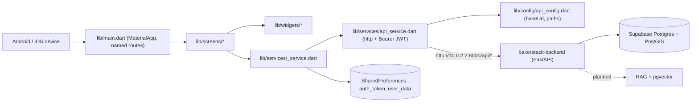

# Project map — bakerstack (Flutter app)



## Folder tree

```
bakerstack_1/  (package name: bakerstack)
├── lib/
│   ├── main.dart            # BakerStackApp: theme, named routes, 404 route (no Provider; services are singletons)
│   ├── config/api_config.dart   # baseUrl, every endpoint path, headers, test credentials (to remove)
│   ├── services/            # api_service (HTTP helper), auth_service (session), cart/order/product/
│   │                        #   wishlist/address/marketplace services, notification_service (badge count only)
│   ├── models/              # address, cart_item, marketplace_item, notification_item, order, product, user
│   ├── screens/             # 25 screens (login, home, cart, checkout, payment, orders, marketplace, profile, ...)
│   ├── widgets/             # product_card, cart_item_widget, wishlist_item, category_item, profile_menu_item
│   ├── theme/app_theme.dart # ThemeData
│   ├── utils/               # colors, constants, theme helpers
├── assets/images/           # bakerstack_logo.png, bakerstack_logo1.png (registered in pubspec.yaml)
├── test/widget_test.dart    # 5 widget tests (all failing at baseline)
├── android/                 # Android host app (applicationId com.example.lib, label "lib")
├── ios/                     # iOS host app (bundle id com.example.lib)
├── web/, windows/, macos/, linux/   # Generated platform folders, not used
├── pubspec.yaml             # Dependencies: http, provider, shared_preferences, intl, url_launcher, image_picker
├── analysis_options.yaml    # flutter_lints
└── docs/                    # Agent docs: this map, FEATURES, SECURITY_TODO, SECURITY_AUDIT
```

## Screens → services

| Screen(s) | Service(s) |
|---|---|
| `splash`, `login`, `register`, `profile`, `edit_profile` | `AuthService` |
| `home`, `product_detail` | `ProductService`, `CartService`, `WishlistService` |
| `cart`, `wishlist` | `CartService`, `WishlistService` |
| `checkout` | `AddressService`, `CartService`, `OrderService` |
| `order_history`, `order_detail` | `OrderService` |
| `delivery_addresses` | `AddressService` |
| `marketplace_feed`, `marketplace_detail`, `create_listing`, `my_listing` | `MarketplaceService` (+ local data in feed/create) |
| `notifications` | none yet (empty until a backend API exists) |
| `edit_listing` | not reachable; save is simulated |
| `buisness_details` | `ApiService` → `/api/business-details/` |
| `payment`, `contact_us` | `Provider.of<ApiService>` (no provider registered → throws; result unused) |
| `about_us`, `terms_privacy` | none (static) |

## Where to look

| Task | Start in |
|---|---|
| Change backend URL or an endpoint path | `lib/config/api_config.dart` (check the backend route first) |
| HTTP behaviour, headers, error handling | `lib/services/api_service.dart` |
| Login, register, session, logout | `lib/services/auth_service.dart`, `screens/login_screen.dart`, `splash_screen.dart` |
| Add a screen / route | `lib/screens/`, then register it in `lib/main.dart` |
| Cart / orders / wishlist / addresses / marketplace logic | `lib/services/<feature>_service.dart` |
| Data shapes from the API | `lib/models/` |
| Colors, theme | `lib/theme/app_theme.dart`, `lib/utils/colors.dart` |
| App name, id, permissions | `android/app/build.gradle.kts`, `android/app/src/main/AndroidManifest.xml`, `ios/Runner/Info.plist` |
| Security status | `docs/SECURITY_AUDIT.md`, `docs/SECURITY_TODO.md` |
